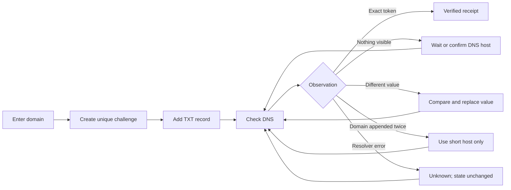
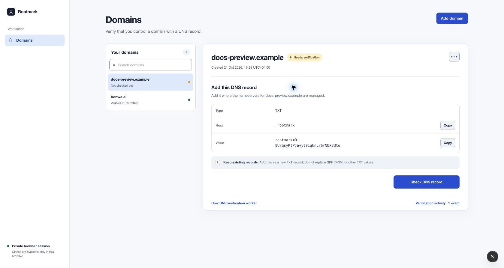
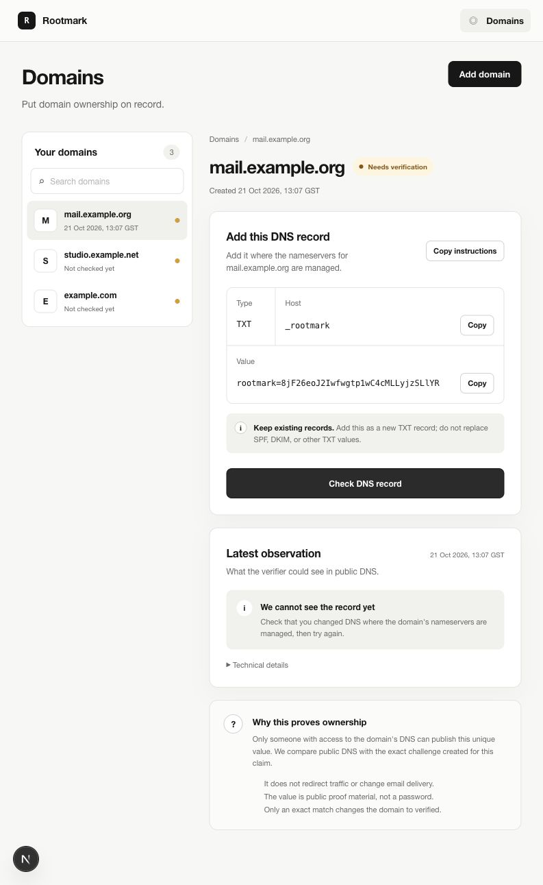
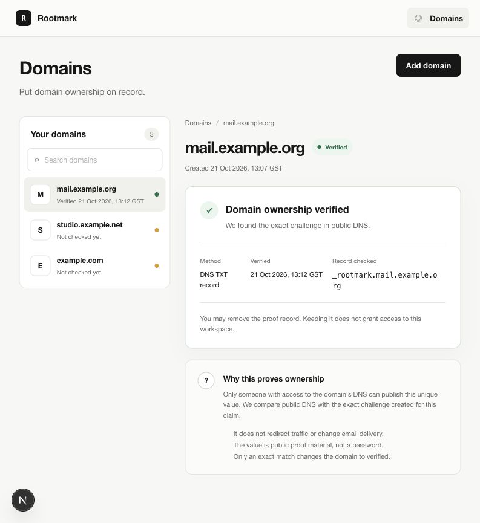
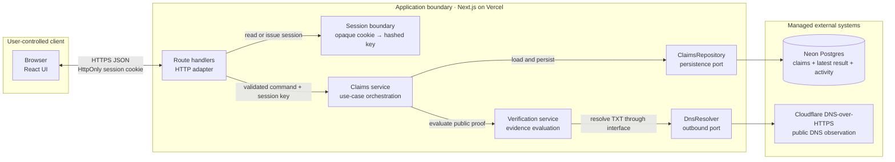
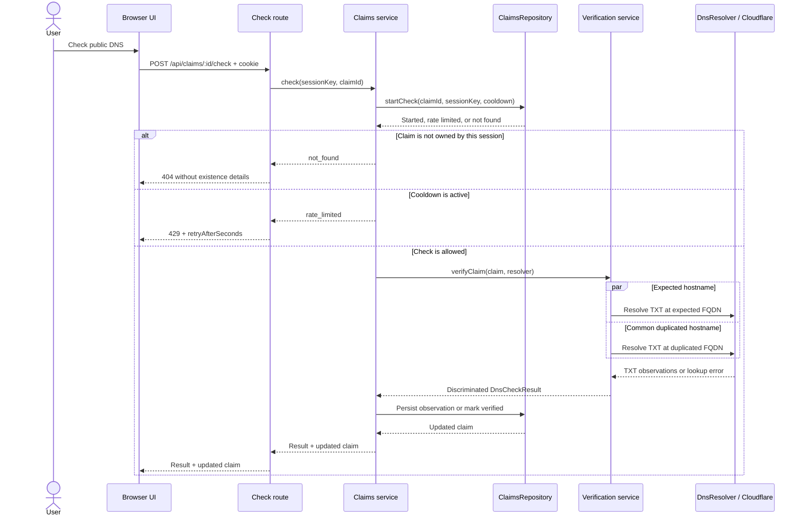

# Rootmark — Product and build spec

Last updated: 21 October 2026

## Why this document exists

This is intentionally a combined product and implementation spec. A traditional PRD explains the user problem, outcomes, and scope; an engineering spec explains states, contracts, architecture, and acceptance criteria. For a focused product build, keeping those decisions together provides one source of truth from intent through implementation.

## Product thesis

Domain verification is a trust-sensitive coordination task disguised as a DNS form. The product should never pretend to know more than the resolver observed, and every unsuccessful check should tell the user what they can safely try next.

The core promise:

> Verify that you control a domain with a DNS record. Then see exactly what we expected, what we found, and what to do next.

## Outcome and scope

A user can claim a domain by creating a unique TXT challenge and can prove control when the deployed backend observes that exact value in public DNS.

The timeboxed product loop is:

1. Enter a domain.
2. Receive one scoped TXT record.
3. Add it wherever DNS is actually managed.
4. Check the record.
5. See a truthful, specific result.
6. Correct mistakes and retry until verified.

### In scope

- Domain normalization and validation.
- One TXT challenge per claim.
- Claims scoped to an anonymous, secure session cookie.
- A claim that survives refresh.
- Real server-side DNS lookup.
- Specific recovery for not found, wrong value, duplicated host, lookup failure, rate limiting, and an already-claimed domain.
- A verified receipt with method and timestamp.
- Removal of a claim owned by the current browser session.
- Responsive and keyboard-accessible UI.

### Deliberately out of scope

- SPF, DKIM, DMARC, or email deliverability setup.
- Registrar OAuth and Domain Connect.
- Multiple verification methods.
- Full accounts, teams, and invitations.
- A delegated handoff link. The UI will make the record easy to copy or forward, but the handoff is not a second authenticated product surface.
- Automatic ownership transfers or dispute resolution.
- A global propagation map.

## Primary use cases

### 1. I control DNS

I enter `example.com`, copy the supplied record into my DNS provider, return, and verify it.

Success means I can tell what to add without understanding DNS terminology and I receive a durable proof receipt only after the server sees the exact token.

### 2. Someone else controls DNS

I can share the visible host and value with a colleague or agency, but delegation
is not presented as a competing primary workflow. A dedicated handoff is a future
extension if research shows that it is common.

### 3. I made a common mistake

I added the record under the wrong host or with the wrong value. The result compares expected and observed values and gives one concrete correction.

Success means the UI does not collapse every non-match into “verification failed.”

### 4. The system could not check

The resolver or network fails. The app says that the result is unknown and leaves the ownership state unchanged.

Success means infrastructure uncertainty is never presented as evidence against the user.

### 5. I manage more than one domain

I can see every domain in the current workspace, search the list, compare verification
statuses, and move between domain details without starting over.

Success means adding a domain grows a manageable collection rather than stacking
another setup form onto a one-off onboarding page.

I can also remove a mistaken or obsolete claim without affecting DNS. Removing the
last domain returns the workspace to its first-run state.

## Main flow



## State model

Claim state and check results are separate concepts. A transient check result must not silently become ownership state.

```ts
type ClaimStatus = "pending" | "verified";

type DnsCheckResult =
  | { kind: "verified"; checkedAt: string; verifiedAt: string }
  | { kind: "not_found"; checkedAt: string }
  | { kind: "wrong_value"; checkedAt: string; observed: string[] }
  | { kind: "wrong_host"; checkedAt: string; observedAt: string }
  | { kind: "lookup_failed"; checkedAt: string; retryable: true };

type StoredCheckResult =
  | DnsCheckResult
  | { kind: "already_claimed"; checkedAt: string };

type CheckResult =
  | StoredCheckResult
  | { kind: "rate_limited"; retryAfterSeconds: number };
```

Rules:

- Only `verified` proves ownership.
- `lookup_failed` and `rate_limited` never mutate claim status.
- A token is unique, random, and bound to one claim.
- The first session to verify a domain owns the active claim; other sessions learn only that it is already claimed, never who claimed it.
- Rechecking a verified claim is allowed. In the MVP, a missing record does not automatically revoke ownership; ongoing re-verification is documented as a production extension.
- The claim stores the latest durable observation for fast rendering and up to 20 deduplicated outcome transitions for a compact, collapsed activity timeline. Repeated identical checks remain server logs rather than user-facing noise.
- Continuous monitoring is not implied by verification. Scheduled rechecks, an append-only audit log, expiry policy, and an evidence-backed revocation flow remain explicit production extensions.
- A domain-existence preflight before claim creation is a potential product add-on, not an ownership signal. It should distinguish an authoritative DNS non-existence response from a temporary lookup failure without blocking valid, newly delegated domains.

## Domain rules

Input is trimmed, lowercased, converted to ASCII/punycode, and stripped of a single trailing dot. The product accepts a registrable hostname or subdomain and rejects:

- URLs, paths, ports, or credentials.
- IP addresses.
- `localhost` and single-label names.
- malformed labels, empty labels, and labels over DNS limits.

The user always sees the normalized value before the challenge is created.

## DNS challenge and diagnosis

Example challenge:

```text
Type:  TXT
Host:  _rootmark
Value: rootmark=<cryptographically-random-token>
```

The server queries `_rootmark.<domain>` through a DNS-over-HTTPS adapter. Keeping lookup behind an interface makes the resolver replaceable and directly testable.

Diagnosis order:

1. Exact token at expected hostname → `verified`.
2. TXT values exist at expected hostname but none match → `wrong_value`.
3. Exact token exists at the common duplicated hostname `_rootmark.<domain>.<domain>` → `wrong_host`.
4. No relevant record → `not_found`.
5. Timeout, malformed resolver response, or upstream failure → `lookup_failed`.

The copy must say “we cannot see it yet,” not “DNS is propagating,” unless the application has evidence from multiple resolvers.

## Trust and safety decisions

- Generate challenges with a cryptographically secure random source.
- Store a server-generated opaque session identifier in an `HttpOnly`, `Secure`, `SameSite=Lax` cookie and persist only its SHA-256 hash.
- Return `404` for a claim owned by another session to avoid leaking claim existence.
- Validate all route inputs at the server boundary.
- Rate-limit DNS checks per claim and bound all claim API traffic at the edge.
- Never interpolate user input into a resolver URL without normalization and encoding.
- Do not display the owner of an existing claim.
- Verification copy explicitly states that adding the TXT record does not change the website, email routing, or other DNS records.
- Do not instruct users to delete existing TXT records.
- Removing a Rootmark claim never implies that Rootmark removed the public TXT record.

## Design rationale

| Choice | Product reason |
| --- | --- |
| Dashboard shell | Frames verification as an ongoing domain-management task rather than a disposable wizard. Only implemented destinations appear in navigation. |
| Master-detail workspace | Keeps the domain collection visible while one claim is configured, checked, or repaired. |
| Explained first-run state | Introduces the three-step proof model and trust boundary before asking for a domain, then reveals the focused form from one clear action. |
| One verification card | Keeps setup, safety guidance, proof explanation, and the latest observation attached to the same claim. |
| Progressive disclosure | Keeps the required action prominent while making proof reasoning and resolver details available on demand. |
| Specific result states | Converts DNS observations into truthful recovery steps instead of collapsing them into “verification failed.” |
| Latest observation + collapsed activity | Keeps the current recovery action prominent while retaining a short, human-readable sequence of meaningful state changes. Raw attempts belong in operational logs, not the product UI. |
| Verified receipt | Records what was proven, how, and when without implying continuous ownership monitoring. |
| Browser-session indicator | Explains the persistence boundary without suggesting that the user has an authenticated account. |

## UX structure

These high-fidelity screens communicate the intended hierarchy, copy, interaction
states, and trust signals. The first two are captures of the running product. The
verified receipt is a deterministic mock of the implemented success state; a final
submission capture will replace it after a real domain passes verification.

### Screen 1 — Multi-domain workspace



The workspace keeps every domain visible and searchable. Selecting a domain opens
its detail view, while “Add domain” remains a clear global action. This structure
scales beyond first-run onboarding without implying that verification is the whole
product.

### Screen 2 — Configure DNS and recover from a missing record



The pending detail keeps the required host and value together, makes each value
individually copyable, warns against replacing existing records, and turns a
missing lookup into a concrete next step. The domain list remains available
throughout the task.

### Screen 3 — Verified proof receipt



The success detail records what was proven, how it was proven, and when. Optional
guidance about removing the TXT record lives in “How DNS verification works,”
while meaningful state transitions live in Verification activity.

## Interaction details

- “Add domain” opens a focused form without hiding or replacing the existing domain collection.
- The header action is hidden while that form is open; first-run begins with an explanatory empty state and reveals the form from one clear action.
- The first-domain form can be cancelled back to the empty state without creating a claim.
- A newly created domain is selected immediately; other domains remain available in the searchable index.
- Form submission is disabled only while the request is pending; validation is shown inline and focus moves to the error summary.
- Copy actions confirm the specific value copied and do not replace visible labels with ambiguous icon-only controls.
- Checking uses a pending state on the button while keeping the instructions readable.
- Status is communicated with text and iconography, not color alone.
- The latest check remains visible after refresh.
- Verification activity opens in a focused dialog and shows at most five recent meaningful
  transitions plus claim creation; consecutive identical outcomes do not create
  duplicate rows.
- “How DNS verification works” opens in a focused dialog and explains why the
  token is public, what Rootmark can read, and what happens after verification.
- Removing a claim requires confirmation, explains that DNS is unchanged, and selects the next domain or first-run state.
- Deletion removes the claim and its per-claim verification activity. The removal
  outcome belongs in retained operational logs, not in an activity view that no
  longer has a claim to attach to.
- All timestamps are rendered in the browser’s timezone with an explicit abbreviation where available.

## Architecture

The system is intentionally one deployable application with explicit internal
boundaries. The diagram separates user-controlled input, trusted application code,
and managed external systems. Interfaces around persistence and DNS keep the core
verification rules testable and provider-independent.



The cookie contains an opaque random identifier; it is not a signed identity token.
Authorization comes from hashing that identifier and matching the result to
`session_key` on every claim operation. Zod parses request data at the route boundary
and validates the Cloudflare response before the resolver exposes TXT observations.

### Resolver decision

Cloudflare is an implementation choice behind `DnsResolver`, not part of the
ownership model. The MVP uses one canonical public resolver so verification has a
single, predictable source of observation.

| Option | Benefits | Cost or risk | Decision |
| --- | --- | --- | --- |
| Cloudflare JSON DoH | No credentials, explicit HTTPS boundary, small readable adapter, and a documented TXT response shape that can be validated with Zod. | The JSON representation is Cloudflare-specific and not an IETF-standard DNS schema. | **Selected.** The adapter is isolated, malformed responses fail closed as `lookup_failed`, and an upstream format change cannot produce false verification. |
| RFC 8484 wire-format DoH | Standards-based and portable across compatible providers such as Cloudflare and Google. | Requires a maintained DNS packet codec and adds binary protocol complexity that does not improve the product flow within this timebox. | Production-hardening option if provider portability or formal protocol stability becomes a requirement. We would use a library rather than implement DNS packet parsing. |
| Node `dns.resolveTxt()` | Minimal application code and native handling of segmented TXT records. | Resolution depends on the deployment runtime's configured DNS transport and recursive resolver rather than an explicit HTTPS service boundary. | Not selected because the deployed observation source should be intentional and visible. |
| Google Public DNS | Offers both RFC 8484 wire format and a JSON API with similar capabilities. | Provides no material MVP advantage over Cloudflare; automatic fallback would make conflicting or time-shifted observations harder to explain. | Kept replaceable through `DnsResolver`, not queried in the primary path. |
| Multiple public resolvers | Can reveal that cached observations currently differ between resolvers. | Requiring consensus increases false negatives; accepting any result expands the trusted surface; user selection weakens the verification policy. | Excluded from verification. A future diagnostic could show secondary observations without allowing them to determine ownership. |
| Direct authoritative lookup or a custom resolver | Maximum control and a view closer to the authoritative source. | Requires correct delegation discovery, retries, TCP fallback, packet parsing, and potentially DNSSEC validation. | Explicitly out of scope. Rootmark owns the proof protocol, not DNS infrastructure. |
| Third-party domain-verification API | Outsources DNS verification and lifecycle management. | Verifies provider-issued records and state rather than Rootmark's challenge, requires credentials, and delegates the product's core trust decision. | Not selected. |

The verification rule remains provider-independent: only an exact match for the
server-generated token at the expected hostname can verify a claim. Multiple
resolvers may become an explainability feature later, but users would not choose
which resolver is authoritative and secondary observations would never weaken the
canonical verification rule.

### Verification request sequence



The route handler owns HTTP parsing, session acquisition, and status-code mapping.
The claims service owns use-case orchestration and acquires the check cooldown
atomically through the repository before making an outbound request. The verification
service performs lookup through an injected `DnsResolver` and returns a typed result;
it does not persist state. Only the repository mutates a claim. A primary resolver
failure therefore produces `lookup_failed` without becoming evidence that the user
does not control the domain, while failure of the optional wrong-host diagnostic
cannot override valid proof observed at the expected hostname.

### Data movement and retention

| Data | Path | Persisted | Exposure boundary |
| --- | --- | --- | --- |
| Domain input | Browser → create-claim route → normalizer | Only the normalized domain | The normalized hostname is later sent to Cloudflare as a DNS query name. The raw input is not retained. |
| Session identifier | Server → `HttpOnly` cookie → route handler → SHA-256 → repository filter | Raw value in the cookie; only its hash in `domain_claims.session_key` | Not readable by client JavaScript and never sent to Cloudflare. It is an authorization handle, not proof of identity. |
| Challenge token | Server generator → repository → owning browser → user-managed public DNS | Claim record | Intentionally becomes public in DNS. It proves control through exact placement; it must not be treated as a secret or authentication credential. |
| TXT observations | Cloudflare DoH → resolver adapter → verification service → route handler | Latest typed check result | Returned only to the owning session. Observed values are disclosed because they help the user repair a mismatch. |
| Verification status | Verification result → repository → owning browser | `pending` or `verified`, timestamps, latest result, and up to 20 deduplicated activity transitions | Never sent to the DNS provider. Another session receives `404` rather than claim details. |
| Raw check attempt | Claims service → structured server log | Operational log only; retention depends on the production log sink | Contains claim ID and outcome only. Session identifiers, challenge tokens, and observed TXT values are excluded. |

Of the application's claim data, the resolver request sends only the DNS query name
and record type to Cloudflare. Session identifiers, claim IDs, and ownership status
remain inside the application boundary. The challenge value may appear in a DNS
response because public visibility is the mechanism of proof.

Suggested modules:

```text
src/
  app/
    api/claims/route.ts
    api/claims/[claimId]/route.ts
    api/claims/[claimId]/check/route.ts
    error.tsx
    global-error.tsx
    page.tsx
  components/
    workspace-sidebar.tsx
    domains/add-domain-panel.tsx
    domains/claim/claim-detail.tsx
    domains/claim/claim-dialogs.tsx
    domains/claim/check-result.tsx
    domains/claim/format-date-time.ts
    domains/domain-list.tsx
    domains/domains-dashboard.tsx
    domains/workspace-skeleton.tsx
  domain/
    claim-api.ts
    claim.ts
    domain-name.ts
  server/
    claims-service.ts
    claims-repository.ts
    memory-claims-repository.ts
    neon-claims-repository.ts
    dns-resolver.ts
    session.ts
    verification.ts
db/
  migrations/001_create_domain_claims.sql
  migrations/002_add_verification_activity.sql
```

Route contracts:

- `GET /api/claims` — return claims belonging to the current session.
- `POST /api/claims` with `{ domain }` — normalize, validate, and create or return the session’s existing claim.
- `DELETE /api/claims/:claimId` — remove an owned claim or return a privacy-preserving `404`.
- `POST /api/claims/:claimId/check` — authorize, enforce cooldown, query DNS, persist the observation, and return the discriminated result.

## Acceptance criteria

- A real TXT record on a controlled domain reaches verified state on the deployed app.
- A page refresh preserves the claim, its latest result, and its meaningful verification activity.
- Exact match, not found, wrong value, wrong host, lookup failure, rate limiting, invalid domain, unauthorized claim, and already-claimed domain are represented intentionally.
- A claim owned by a different session returns `404`.
- Removing a claim is session-isolated and does not claim to alter public DNS.
- The UI never claims verification before a server-side DNS match.
- Core domain normalization and every verification result have automated tests.
- The README explains the product thesis, security decisions, setup, tradeoffs, and known limits.

## Demo narrative

1. State the thesis: a trust workflow should distinguish “not proven” from “failed.”
2. Create a claim and explain why the TXT record is harmless and uniquely scoped.
3. Show an intentional wrong value and the observed-versus-expected recovery UI.
4. Correct the record and verify against real DNS.
5. Show the receipt, session isolation, state model, and one deliberate scope tradeoff.

